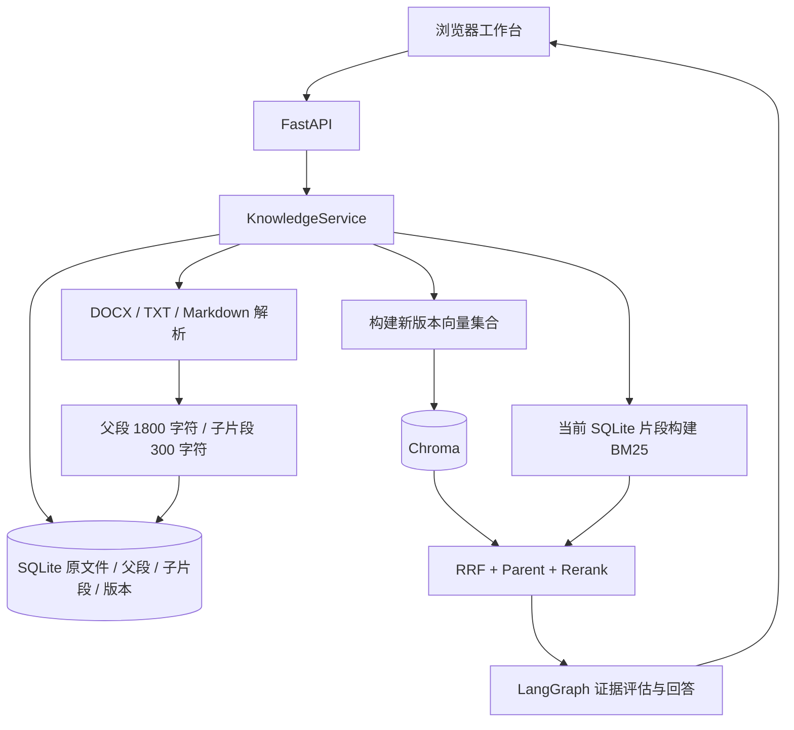

# 前后端与知识库管理开发详解

本文对应本次补充的实际代码。重点解释每一步做了什么、怎么做、为什么这么做，并给出可以自行验证的操作。

## 一、先理解原项目

原项目围绕一份大学章程构建中文 RAG，核心模块已经具备：

| 模块 | 现有文件 | 原来负责什么 |
| --- | --- | --- |
| 文档加载 | `src/loaders/docx_loader.py` | 根据“第几章、第几条”解析指定 DOCX |
| 文本切分与 ID | `src/vectorstores/id_utils.py` | 为子片段生成文档、父文档、分块及内容哈希 |
| 向量模型 | `src/embeddings/embedding_model.py` | BGE 文本向量化 |
| 持久向量库 | `src/vectorstores/chroma_store.py` | Chroma 同步、删除和相似度检索 |
| 关键词检索 | `src/retrievers/bm25_retriever.py` | jieba 分词与 BM25 |
| 混合召回 | `src/retrievers/hybrid_retriever.py` | Dense 与 BM25，通过 RRF 融合排名 |
| 上下文恢复 | `src/retrievers/parent_retriever.py` | 子片段命中后恢复完整父段 |
| 精排 | `src/retrievers/reranker.py` | CrossEncoder 比较问题与候选父段 |
| Agent | `src/agent/workflow.py` | 改写、检索、评估证据、重试、生成和校验引用 |
| 服务与 API | `src/services/agent_service.py`、`src/api/main.py` | 加载固定文档并提供提问接口 |

原先缺少的是应用层：用户无法创建知识库、上传新资料或检查文档是否进入索引。原 `AgentService` 在启动时读取写死的文件，并用“Chroma 记录数等于当前块数”判断索引可用；即使记录数相同，内容也可能已经变化，因此不能用于知识库版本管理。

本次保留检索和 Agent 算法，将“文档如何管理”和“向哪个知识库提问”独立出来。

## 二、开发后的整体流程



这里的 1800/300 都是字符级近似长度，不是 token 数。中文、英文和标点在实际模型中的 token 数不同。

数据以 SQLite 中的文档记录为准，Chroma 是可以重新生成的派生索引。这样，即使模型暂时不可用，仍然可以管理文档、查看分块和执行关键词检索。

## 三、第一步：补齐配置，拆开启动与模型加载

**做了什么：** 新增 `src/config.py`，补充 `.env.example` 与 `requirements.txt`。

**怎么做：** `Settings.from_env()` 从项目 `.env` 和环境变量读取配置，包括数据目录、embedding 路径、reranker 路径、设备、上传大小。已有的真实 `.env` 不需要覆盖。

| 变量 | 用途 | 默认行为 |
| --- | --- | --- |
| `RAG_DATA_DIR` | 新管理系统数据位置 | `data/knowledge` |
| `RAG_EMBEDDING_MODEL` | BGE 模型目录或名称 | 项目已有本地 BGE 目录 |
| `RAG_RERANKER_MODEL` | 重排序模型目录或名称 | `BAAI/bge-reranker-base` |
| `RAG_DEVICE` | 推理设备 | `cpu` |
| `RAG_MAX_UPLOAD_MB` | 单文件大小限制 | 20 |
| `DASHSCOPE_API_KEY` | 生成回答的大模型密钥 | 没有时返回可读提示 |
| `DASHSCOPE_BASE_URL` | 兼容接口地址 | 阿里云 DashScope |
| `RAG_LLM_MODEL` | 生成模型 | `qwen-plus` |

FastAPI 启动只创建 `KnowledgeService` 和数据库；真正重建索引时才加载 embedding，混合检索时才加载 reranker，提问时才创建大模型客户端。模型对象在单进程内复用，避免每次检索重复加载权重。

**为什么这样做：** 原先启动依赖所有模型、原文和 Chroma 数量完全匹配，任何环节出错都会导致 API 起不来。拆开之后，资料管理可以先运行，模型问题也更容易定位。

## 四、第二步：建立知识库和文档的数据模型

**做了什么：** 在 `src/services/knowledge_service.py` 中建立两张 SQLite 表。

### 1. `knowledge_bases`：知识库目录与索引指针

| 字段 | 含义 |
| --- | --- |
| `id` | UUID，是接口请求中的 `knowledge_base_id` |
| `name`、`description` | 名称和说明，名称唯一 |
| `created_at` | UTC 时间，前端按用户本地时区显示 |
| `revision` | 当前资料版本，上传、替换或删除文档时递增 |
| `indexed_revision` | 最近一次成功构建索引对应的资料版本，初始为 -1 |
| `collection` | 当前生效的 Chroma 集合名称 |
| `index_error` | 最近一次索引失败的简要说明 |

知识库编辑名称和说明不改变文档内容，因此不递增资料版本。列表通过 `revision == indexed_revision` 判断索引就绪。

### 2. `documents`：原文件与解析结果

| 字段 | 含义 |
| --- | --- |
| `id` | 文档 UUID，下载、替换、删除接口使用它 |
| `kb_id` | 所属知识库，外键级联删除 |
| `filename` | 清理后的展示文件名 |
| `content_hash` | 原文件完整 SHA-256，用于同库内容去重 |
| `size`、`created_at` | 原文件字节数和最近写入时间 |
| `parents` | 父段 JSON，保存正文与元数据 |
| `chunks` | 子片段 JSON，保存正文与元数据 |
| `raw` | 原始上传字节，供下载 |

`UNIQUE(kb_id, content_hash)` 阻止同一个知识库重复上传同样内容；不同知识库可以保存同一文件。同名但内容不同的文件也允许存在，避免只靠文件名去重造成误判。

**为什么把原文件存 SQLite：** 当前定位为小型本地应用，原文件、解析结果和资料版本可以一次事务提交，不需要额外处理“磁盘写成功、数据库失败”的补偿逻辑。后续有大文件或高并发需求时，应将原文件迁移到对象存储，并增加上传任务表。

数据库连接使用 `closing()` 保证关闭，内部事务上下文保证提交或回滚。仅使用 `with sqlite3.connect(...)` 并不能保证连接立即关闭，这一点已在 Windows 测试中修复。

## 五、第三步：实现上传校验与通用解析

**做了什么：** 新增 `src/loaders/knowledge_loader.py`，让系统支持 DOCX、TXT、Markdown，而不局限于章程。

**怎么做：** 上传接口读取最多“配置上限 + 1”字节，然后在线程池中调用服务，按照以下顺序处理：

1. 确认知识库存在；替换时额外确认目标文档属于该知识库。
2. 检查文件大小，超限返回 413。
3. 清理路径，只保留文件名。例如 `../../制度.txt` 只保存为 `制度.txt`。系统不会把这个名字当作服务端写入路径。
4. 校验扩展名，只接受 `.docx`、`.txt`、`.md`。
5. DOCX 先检查 ZIP 容器声明的解压总大小，再用 `python-docx` 读取段落与表格；损坏文件返回可读错误。
6. TXT 和 Markdown 按 UTF-8 或带 BOM 的 UTF-8 解码；其他编码返回 422，提示先转换编码。
7. 拒绝空文本或含 NUL 的文本，再提取父段和子片段。
8. 计算完整原文件哈希，在数据库唯一约束中完成最终去重。
9. 在一个事务中保存原文件、父段、子片段并递增 `revision`。

批量上传由前端逐个发起请求并汇总结果。一份文件失败不会撤销其他成功文件，页面会显示每份失败原因。它不是整批文件的单一事务。

**DOCX 的处理边界：** 普通段落按原顺序读取，表格以行文本形式追加到正文末尾；目前不保留表格与段落交错的原始排版顺序，也不解析页眉页脚、文本框和图片文字。Markdown 以文本处理并识别标题，不渲染为 HTML。

## 六、第四步：生成父段、子片段和稳定 ID

**做了什么：** 延续原项目的父子检索思路，但支持普通文本和同名文档。

**怎么做：** 先识别“第几章”“第几条”和 Markdown 标题。没有这些结构时，以段落组织父段。过长父段继续拆到约 1800 字符；每个父段再拆成约 300 字符的子片段，子片段重叠 50 字符，尽量保留句子边界。

每个片段保留这些元数据：

```text
source        = 原文件名
chapter       = 章节或 Markdown 标题
article       = 条款/段落标签 + 父段序号
document_id   = hash(知识库 UUID + 文档 UUID)
parent_id     = hash(document_id + chapter + article)
chunk_id      = hash(parent_id + chunk_index)
chunk_index   = 该父段中的子片段位置
content_hash  = 子片段正文哈希
```

分块继续复用 `prepare_chunks()`。预览接口中的 `document_id` 是检索元数据哈希；文档 API 路径使用数据库 UUID，二者作用不同。

**为什么需要单独的父段 ID：** 如果两份不同文件都叫“制度.docx”，又都有“第一章、第一条”，原先三元组定位会互相覆盖。新解析器让父段和子片段都包含一致的 `parent_id`，因此同名文件也能准确恢复上下文。

`ParentRetriever` 根据父段是否具备结构化 ID 选择定位方式。对于原来的脚本，父段没有 ID、子片段经 `prepare_chunks()` 后有 ID，仍沿用旧三元组方式；这条兼容路径有独立回归测试。

稳定是指同一文档身份、章节标签和片段位置重复处理时 ID 一致。插入新段落可能改变后续位置，当前实现没有承诺编辑前后所有片段 ID 永远不变，因此管理层采用完整快照重建。

## 七、第五步：把索引重建做成可恢复的版本切换

**做了什么：** `KnowledgeService.rebuild()` 不直接覆盖正在使用的集合，而是建立新集合，验证后切换指针。

**怎么做：**

1. 获取进程内重入锁，阻止文档修改、其他索引或问答与本次操作交错。
2. 从 SQLite 读取该知识库当前版本及全部子片段。
3. 创建唯一的新 Chroma 集合名：`kb_知识库UUID_随机UUID`。
4. 按 `document_id` 分组，调用已有 `ChromaStore.sync_document()` 写入。
5. 每次最多向量化和写入 128 个子片段，限制模型内存峰值及 Chroma 请求批次大小。
6. 校验新集合记录数等于预期子片段数。
7. 在 SQLite 事务中更新 `collection` 和 `indexed_revision`，清空旧错误。
8. 提交成功后尝试删除旧集合，释放派生索引。

如果任何构建步骤失败，删除本次不完整集合，记录错误并返回 503，旧索引指针保持原值。若旧集合清理失败，记录日志，不把已经提交成功的操作伪装成失败。

例如，当前 `revision=3`、`indexed_revision=3` 可以混合检索。上传新文档后变成 `revision=4`、`indexed_revision=3`，页面显示“待重建”，混合检索返回 409。重建成功后两个版本都是 4；如果模型加载失败，仍保留版本 3 的集合，但不会把旧索引与版本 4 的关键词语料混合使用。

删除最后一份文档后重建，会将索引标记为空、移除旧集合，不加载模型。空库检索会提示先上传文档。

**这里为什么不用原有增量同步直接更新生效集合：** 原有 `sync_document()` 适合一份文档的分块同步，但没有跨全部文档的事务。新集合快照让失败时保留旧版本更直观，代价是重建期间暂时占用两份索引空间，并需要重新计算当前库的全部向量。

当前没有处理进程被强制结束后遗留集合的自动垃圾回收；这些集合不会成为生效索引。单进程锁也不适用于多个 Uvicorn worker，因此当前只支持一个 worker。

## 八、第六步：按知识库组装检索与问答

**做了什么：** 用 `knowledge_base_id` 明确每次检索和问答的数据范围，复用现有算法。

### 关键词模式

从当前知识库 SQLite 子片段构建 BM25，关键词召回后恢复父段，再返回正文、章节和分数。它不依赖 Chroma，也不要求已重建索引，可用于快速检查上传解析效果。

BM25 当前按请求重建内存索引，没有持久缓存；小型本地知识库便于保证与当前文档一致。分数低或为零的候选仍可能返回，不能将“有检索结果”理解为“有充分回答证据”。

### 混合模式

先检查资料版本与索引版本一致，再执行原有流程：

```text
问题
  ├─ BGE query embedding → Chroma Dense 候选
  └─ jieba 分词 → BM25 候选
                ↓
             RRF 排名融合
                ↓
          parent_id 恢复完整父段
                ↓
       CrossEncoder 计算重排序分数
                ↓
             返回 Top K 父段
```

每路默认取最多 72 个候选，父段候选上限至少 10，检索测试可选择最终返回 3、5 或 10 段。Dense、BM25 和 reranker 的分数含义不同，页面分别显示召回分数和重排分数，不把它们当成统一置信度。

### 知识问答

`AgentService` 不再自行读取固定文件，而是接收当前知识库的 `retrieval_pipeline`。原 LangGraph 流程保持：改写查询 → 检索 → 判断证据 → 生成或重试/回退 → 引用编号校验。

`RAGGenerator` 的来源记录新增 `content`、`document_id` 和 `parent_id`。前端可展开 `[1]`、`[2]` 查看该次答案真正使用的父段原文。文档日后变化，不会改变已经显示的本次证据快照。

编号校验仅确认回答引用了合法编号，不验证答案是否真正被原文蕴含。因此页面明确显示“编号校验通过（不代表事实核验）”。没有证据时保留原 Agent 的回退答复。每次提问独立处理，当前没有多轮记忆或聊天记录持久化。

## 九、第七步：补齐 API，并连接前端

**做了什么：** 在 `src/api/main.py` 中提供管理、检索、问答接口，并托管 `frontend/`。

| 方法 | 路径（均除健康检查外带 `/api/v1` 前缀） | 用途 |
| --- | --- | --- |
| GET | `/knowledge-bases` | 列表与统计 |
| POST | `/knowledge-bases` | 创建知识库 |
| PUT | `/knowledge-bases/{kb_id}` | 编辑名称和说明 |
| DELETE | `/knowledge-bases/{kb_id}` | 删除知识库及其文档 |
| GET | `/knowledge-bases/{kb_id}/documents` | 文档列表 |
| POST | `/knowledge-bases/{kb_id}/documents` | multipart 上传单个文件 |
| PUT | `/knowledge-bases/{kb_id}/documents/{doc_id}` | 替换原文件并重新解析 |
| DELETE | `/knowledge-bases/{kb_id}/documents/{doc_id}` | 删除文档 |
| GET | `/knowledge-bases/{kb_id}/documents/{doc_id}/chunks` | `offset` / `limit` 分页预览 |
| GET | `/knowledge-bases/{kb_id}/documents/{doc_id}/download` | 下载原始上传字节 |
| POST | `/knowledge-bases/{kb_id}/reindex` | 同步构建新索引，等待完成后返回 |
| POST | `/search` | 关键词或混合检索 |
| POST | `/ask` | 当前知识库问答 |
| GET | `/health`（无前缀） | 统计、密钥是否配置、上传限制 |

请求示例：

```json
{
  "knowledge_base_id": "创建知识库返回的id",
  "question": "报销需要谁审批？",
  "mode": "keyword",
  "top_k": 3
}
```

以上 JSON 用于 `/api/v1/search`；问答只需要前两项。

参数由 Pydantic 校验：名称去除首尾空格、问题不得全为空白、问题最长 2000 字符、返回数为 1–10、模式限制为 keyword/hybrid。404 表示对象不存在，409 表示同名/重复或需要更新索引，413 表示超限，422 表示输入或文件无效，503 表示模型/外部服务暂不可用。

文件解析放在线程池执行；同步检索、建索引等使用同步路由，由框架调度到线程池。服务层仍通过锁保证一致性。浏览器会等待索引请求完成，当前没有任务进度轮询或后台任务队列。

## 十、第八步：实现前端交互

**做了什么：** 新增 `frontend/index.html`、`styles.css`、`app.js`。使用原生 HTML/CSS/JavaScript，不引入构建工具，便于在现有 Python 项目直接启动。

页面分成四个区域：左侧知识库切换，顶部统计，文档管理，检索测试/问答。

**怎么做：**

1. `api()` 统一处理 fetch、JSON、204 空响应和接口错误。
2. `state` 保存当前知识库、操作忙碌状态和预览分页位置。
3. `refresh()` 刷新知识库列表、统计和文档表格。
4. `task()` 在操作期间禁用相关按钮，防止重复上传或重复提交。
5. 上传使用 `FormData`；拖拽和多选共享同一个处理函数。
6. 替换时通过原文档 UUID 调用 PUT，不创建额外文档记录。
7. 预览每页取 10 个片段，显示条款标签与 chunk ID，便于对照数据库。
8. 切换知识库时清空上一知识库的检索结果与会话展示，避免误认资料范围。
9. 删除文档和知识库弹出确认，知识库删除明确提示不可撤销。
10. API 返回的文档正文和模型答案都用 `textContent` 写入，不通过 `innerHTML` 执行或渲染不可信内容。
11. 页面按窗口高度分配空间；内容面板内部滚动，表格在小屏内部横向滚动。问答区的标题和输入区保持可见，消息列表独立滚动，多轮回答或展开引用不会继续撑高页面。
12. 发送问题后滚动到最新消息；如果等待回答期间向上阅读历史，回答到达时保留阅读位置，通过“回到最新消息”返回底部。支持清空当前展示记录、Ctrl / ⌘ + Enter 发送、Enter 换行。

前端和 API 同源部署，因此当前无需额外的跨域配置。FastAPI 的上传参数和静态文件托管方式参考其官方说明：[文件上传](https://fastapi.tiangolo.com/tutorial/request-files/)、[静态文件](https://fastapi.tiangolo.com/tutorial/static-files/)。Chroma 集合作为隔离与版本切换单位，参考 [Chroma 集合管理](https://docs.trychroma.com/docs/collections/manage-collections)。

## 十一、如何验证这次开发

### 1. 不调用外部模型的接口回归

```powershell
python -m unittest discover -s tests -v
```

`tests/test_knowledge_api.py` 使用真实 SQLite、真实 DOCX/TXT 解析和真实 BM25，替换向量模型与外部 LLM 边界。覆盖知识库增删改、重启持久化、级联删除、文件去重与校验、分页、下载、替换、跨库访问、同名文件父段隔离、失败索引保留、重建恢复、空库重建、普通 DOCX 表格、旧脚本父段兼容，以及实际 LangGraph 流程中的引用返回。

失败索引测试会故意注入异常，日志中出现 `simulated embedding failure` 是预期行为；最终以 unittest 的 `OK` 为准。

### 2. 真实模型与 Chroma 验证

```powershell
python scripts/31_smoke_knowledge.py
python scripts/31_smoke_knowledge.py --hybrid
```

脚本使用独立临时目录，检查真实 BGE 向量写入、检索、服务重新连接和删除。加 `--hybrid` 后额外测试 Dense + BM25 + RRF + Parent + 真实 CrossEncoder。它不访问付费大模型接口。Windows 下 Chroma 原生句柄可能在进程存活期间保持打开，测试临时目录留给操作系统清理。

### 3. 浏览器交互验证

`tests/browser_smoke.cjs` 驱动 Edge，完成创建、上传、分块预览、关键词检索、替换、删除，以及 1440px 桌面和 390px 手机宽度检查。记录页面 JavaScript 异常，截图写入 `tests/artifacts/`。

### 4. 真实大模型验收

本次自动测试没有调用实际付费 DashScope 问答。配置真实密钥后，可在页面用“报销需要谁审批”这类文档内问题验证答案，再用“资料未涉及的价格/日期”等问题验证证据不足回退。模型质量和具体回答还需要结合真实业务资料评估。

## 十二、后续生产化顺序

当前代码已经覆盖本地管理与问答的基本闭环，但不是完整企业生产部署。建议后续按以下顺序扩展：

1. 登录及知识库权限：把用户身份、知识库归属和访问校验贯穿所有接口。
2. 索引任务队列：将同步重建改为任务表 + 独立 worker，增加进度、取消、重试与崩溃恢复。
3. 对象存储与关系数据库：原文件外置，按租户和知识库组织路径，补齐事务补偿与备份。
4. 多进程一致性：使用跨进程/分布式锁、版本比较提交与检索快照，替换当前进程内锁。
5. 增量索引与缓存：按文档内容哈希复用向量，缓存同一资料版本的 BM25 与父段索引。
6. 更多解析器：PDF、OCR、复杂表格、页码和原文定位；通过解析器接口扩展，保留统一元数据。
7. 检索评测：维护有标准证据的问题集，度量召回率、排序质量、拒答与答案忠实度。
8. 审计与观测：记录文档操作、模型耗时、索引版本和失败原因；补充限流、监控与备份恢复演练。
